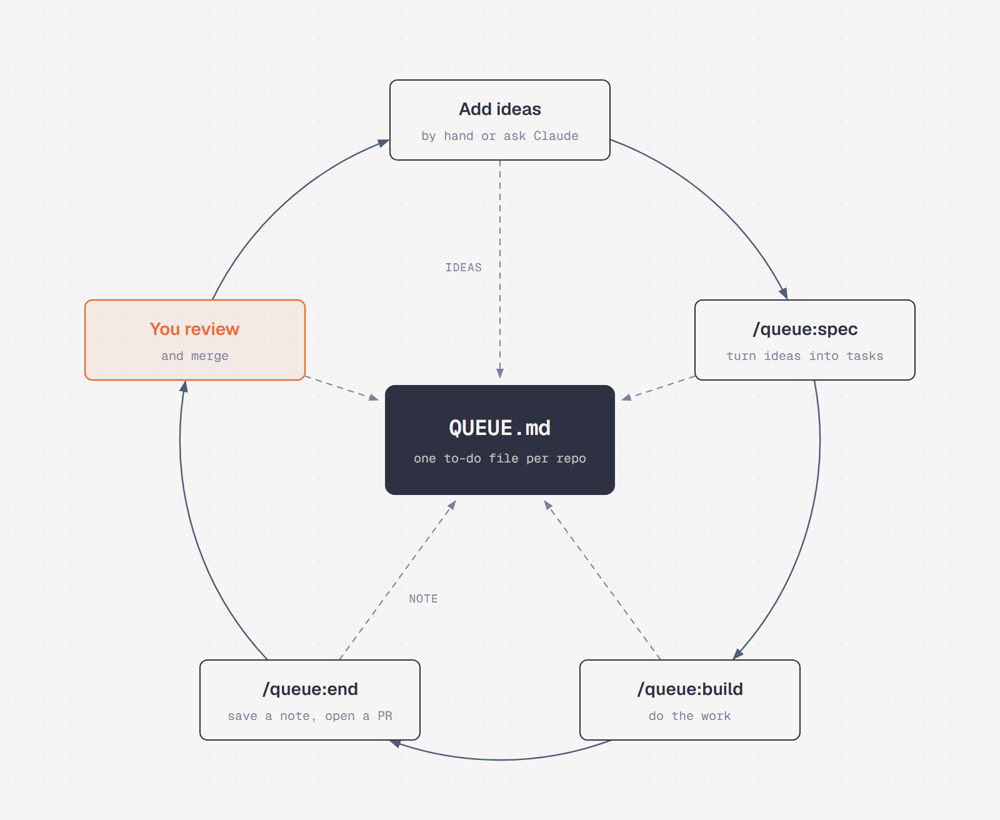

# queue-lanes

A Claude Code plugin that lets every session start knowing what to do and end by telling the
next one where to pick up.

Each repo keeps one to-do file, `QUEUE.md`. You open a session with the command for the kind of
work you want done, and close it with `/queue:end`, which saves a short note for the next session
and opens a pull request with the work.

## How it works

<p align="center">
  
</p>

1. Add ideas and tasks to `QUEUE.md`, by hand or by asking Claude.
2. Run `/queue:spec` to turn them into small, clear tasks.
3. Run `/queue:build` to do them. Open several terminals to work on separate tasks at once.
4. Every session ends with `/queue:end`. Review and merge its pull request, then start the next
   session.

## Install

In Claude Code:

```text
/plugin marketplace add Strong-Force-Analytics/claude-plugins
/plugin install queue@sfa-plugins
```

Then, in your repo:

```text
/queue:init
```

This adds `QUEUE.md`, copies in any existing to-do list, and opens a pull request with the setup.

Needs `git` and the GitHub CLI (`gh`), signed in.

## Commands

| Command | What it does |
|---|---|
| `/queue:init` | Sets the repo up, once |
| `/queue:spec` | Makes the open decisions and turns ideas into small, clear tasks |
| `/queue:build` | Does the next tasks, each with a check that proves it's finished |
| `/queue:audit` | Checks that the docs and the code still agree, and fixes the gaps |
| `/queue:meta` | Improves the process itself: the commands, rules and scripts |
| `/queue:end` | Saves a note for the next session and opens a pull request |

## Good to know

- **Pull requests by default.** `/queue:end` never merges; you do. A repo where one person works
  alone can switch to pushing directly, with `Land: push` in its `CLAUDE.md`.
- **Optional helpers.** With the
  [architect-crew](https://github.com/Strong-Force-Analytics/architect-crew) plugin installed,
  sessions hand reading, test runs and simple edits to cheaper models.
- **More detail.** The [visual guide](docs/session-lanes-guide.html) walks through a full day,
  and [Add to an existing repo](docs/add-to-existing-repo.md) shows the setup by hand.

## Credits

The method and the commands are by [Brett Ragozzine](https://github.com/brag42). Packaged as a plugin by
[Strong Force Analytics](https://github.com/Strong-Force-Analytics).

## License

[MIT](LICENSE)
